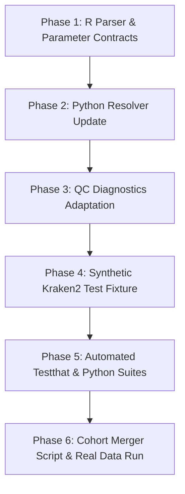

# Kraken2 & Bracken Upstream Support Implementation Plan

**Document:** `kraken2-support-implement.md`
**Target Version:** `v0.5.0`
**Audited Baseline:** `3522ebce073ed44573183e2a88da833da9c6636b` (v0.4.9)
**Repository:** [ont-wf16S-amplicon-postprocess](file:///d:/W/SAL-AmpliSeq/NabAur-SoilITS/ont-wf16S-amplicon-postprocess)
**Status:** Implementation Ready

---

## 1. Executive Summary & Objective

The **ONT wf-16S Amplicon Post-Processing Pipeline** currently enforces a strict single-classifier contract: it requires `--classifier minimap2` from Oxford Nanopore's [EPI2ME wf-16s](https://github.com/epi2me-labs/wf-16s). If run on outputs where `wf-16s` was executed with Kraken2 (`--classifier kraken2`), the pipeline halts at preflight validation in `analysis/utils/io.R`:

```text
Unsupported wf-16s classifier 'kraken2'. This pipeline supports minimap2 only; Kraken2/Bracken requires a classifier-specific denominator model.
```

Furthermore, both the R streaming reader (`analysis/utils/io.R`) and the Python taxonomy resolver (`analysis/utils/ncbi_taxonomy.py`) enforce an exact 5-field TSV format for read assignments (`*.assignments.tsv`). In contrast, `wf-16s` under Kraken2 outputs a 6-field TSV containing k-mer hit lists.

### Primary Objective
Deliver end-to-end, deterministic support for **Kraken2 and Bracken** results from `wf-16s` without breaking existing Minimap2 pipelines, weakening strict validation gates, or compromising exact read-count reconciliation.

---

## 2. Upstream Contract Evidence & Analysis

Detailed inspection of real Kraken2 outputs from `wf-16s` (specifically `wf-16s_Biomecon-ITS-kraken2` and `wf-16s_Knegative-ITS-kraken2`) against the existing pipeline baseline confirms the following invariants:

### 2.1. Parameter Contract (`params.json`)
* Both Minimap2 and Kraken2 runs produce `params.json` containing:
  * `"classifier"`: `"kraken2"` (vs `"minimap2"`).
  * `"database_set"`: `"ncbi_16s_18s_28s_ITS"` or `"ncbi_16s_18s"` (both already present in `analysis/contracts/upstream_database_sets.json`).
  * `"taxonomic_rank"`: `"S"`.
  * Common quality & length fields: `min_len`, `max_len`, `min_read_qual`, `abundance_threshold`.
  * Kraken2-specific fields: `kraken2_confidence` (default `0`), `bracken_threshold` (default `10`), `bracken_length` (nullable integer).
* Kraken2 runs still record default/configured values for `min_percent_identity` and `min_ref_coverage` in `params.json`, but these thresholds are not applied downstream because no BAM alignments are generated.

### 2.2. Species Abundance Table (`abundance_table_species.tsv`)
* Kraken2 + Bracken runs produce **the exact same 8-rank schema** as Minimap2:
  * Column 1: `tax` with 8 semicolon-delimited ranks (`superkingdom;kingdom;phylum;class;order;family;genus;species`).
  * Row 1: Synthetic unclassified row: `Unclassified;Unknown;Unknown;Unknown;Unknown;Unknown;Unknown;Unknown`.
  * Sample columns: Non-negative integer or whole-number counts.
  * Total column: Reconciles exactly to the row sum across sample columns.

### 2.3. Assignments TSV Contract (`*.assignments.tsv`)
* **Minimap2 Format (5 columns, tab-delimited, no header):**
  1. `Status` (`C` or `U`)
  2. `Read ID` (UUID string)
  3. `TaxID` (Canonical integer string, or `0` if filtered by identity/coverage)
  4. `Length` (Integer or `0|length` / `1|length`)
  5. `Lineage` (Pipe-delimited ranks)
* **Kraken2 Format (6 columns, tab-delimited, no header):**
  1. `Status` (`C` or `U`)
  2. `Read ID` (UUID string)
  3. `TaxID` (Canonical integer string; `0` if and only if `Status == "U"`)
  4. `Length` (Positive integer)
  5. `K-mer Hits` (Space-delimited list of `TaxID:kmer_count` pairs, e.g. `254056:2 0:5 4751:4...`)
  6. `Lineage` (Pipe-delimited ranks)

### 2.4. Mathematical Reconciliation & Denominator Models
* In Minimap2:
  * Reads with status `C` and `TaxID == 0` represent reads that aligned to the reference but failed the minimum identity or reference coverage thresholds (`n_qc_reclass`).
  * Effective classified reads are defined as $\text{taxid} > 0$.
* In Kraken2:
  * Status `C` reads **always** have $\text{taxid} > 0$.
  * Status `U` reads **always** have $\text{taxid} == 0$.
  * There is no intermediate `C + TaxID 0` state (`n_qc_reclass == 0`).
  * **Empirical Validation:**
    * In `Biomecon_ITS-kraken2`: Total lines = 40,204; `Status C` = 15,559; `Status U` = 24,645.
    * In `abundance_table_species.tsv`: `Unclassified` = 24,645; Sum of classified species = 15,559.
    * Total abundance = 40,204. Reconciliation error = 0 reads (100% exact).

---

## 3. Required Behavior Contracts

1. **Dual Classifier Support**:
   The pipeline must accept both `minimap2` and `kraken2` as valid `classifier` values in `params.json`. Any other classifier must fail closed with an explicit error code.
2. **Transparent Assignment Ingestion**:
   Both R and Python assignment readers must inspect row field counts and branch safely:
   * 5 fields $\rightarrow$ Minimap2 parser (extract length from field 4, lineage from field 5).
   * 6 fields $\rightarrow$ Kraken2 parser (extract length from field 4, validate k-mer hits in field 5, extract lineage from field 6).
   * Any other field count ($\ne 5$ and $\ne 6$) must raise a schema violation with physical line numbers.
3. **Graceful Handling of Alignment Diagnostics**:
   * Kraken2 runs do not produce BAM files or `bamstats.readstats.tsv.gz`.
   * Preflight checks must not attempt to partition BAM stats when `classifier == "kraken2"`.
   * Module `01_qc_diagnostics.R` must report `BamstatsAvailable = FALSE`, `C_TaxID0 = 0`, and adjust Figure 1c labels to reflect k-mer classification rather than alignment filtering.
4. **Preservation of Downstream Modules**:
   Modules 02 (alpha diversity), 03 (beta diversity), 04 (taxa composition), 05 (ordination), 06 (shared taxa), 07 (kreport & Pavian), and 08 (FAPROTAX) operate on the species count matrix and lineage strings. They require **zero algorithmic modifications**, as the count matrix semantics remain strictly identical.

---

## 4. Concrete Code Touch Points & Proposed Diffs

### 4.1. `analysis/utils/io.R`

#### A. Expand Supported Classifiers in `read_upstream_params()`
```diff
+SUPPORTED_CLASSIFIERS <- c("minimap2", "kraken2")
 SUPPORTED_NCBI_DATABASE_SETS <- c("ncbi_16s_18s", "ncbi_16s_18s_28s_ITS")

-  if (!identical(classifier, "minimap2")) {
-    stop(sprintf(
-      "Unsupported wf-16s classifier '%s'. This pipeline supports minimap2 only; Kraken2/Bracken requires a classifier-specific denominator model.",
-      classifier
-    ), call. = FALSE)
-  }
+  if (!classifier %in% SUPPORTED_CLASSIFIERS) {
+    stop(sprintf(
+      "Unsupported wf-16s classifier '%s'. Supported classifiers: %s.",
+      classifier, paste(SUPPORTED_CLASSIFIERS, collapse = ", ")
+    ), call. = FALSE)
+  }
```

#### B. Update Assignment Validation Chunk (`validate_assignment_chunk()`)
```diff
 validate_assignment_chunk <- function(lines, sample_id, line_numbers, seen_read_ids) {
   fields <- strsplit(paste0(lines, "\t"), "\t", fixed = TRUE)
   field_counts <- lengths(fields)
-  if (any(field_counts != 5L)) {
-    bad_index <- which(field_counts != 5L)[1]
+  invalid_fields <- !(field_counts %in% c(5L, 6L))
+  if (any(invalid_fields)) {
+    bad_index <- which(invalid_fields)[1]
     stop(sprintf(
-      "Assignments file for sample '%s' has %d fields at line %d; expected exactly 5.",
+      "Assignments file for sample '%s' has %d fields at line %d; expected 5 (minimap2) or 6 (kraken2).",
       sample_id, field_counts[bad_index], line_numbers[bad_index]
     ), call. = FALSE)
   }
```

#### C. Handle 5-Column vs 6-Column Branching in `validate_assignment_chunk()` and `read_assignments_file()`
In chunk validation and row assembly:
```r
is_six_col <- ncol(fields) == 6L
status <- fields[, 1]
read_id <- fields[, 2]
taxid_text <- fields[, 3]
length_field <- fields[, 4]
kmer_hits <- if (is_six_col) fields[, 5] else NULL
lineage <- if (is_six_col) fields[, 6] else fields[, 5]

if (is_six_col) {
  # Validate kmer hit string contains non-empty, safe characters
  if (any(!is_tsv_safe_identifier(kmer_hits))) {
    bad_index <- which(!is_tsv_safe_identifier(kmer_hits))[1]
    stop(sprintf("Assignments file for sample '%s' has invalid k-mer hits at line %d",
                 sample_id, line_numbers[bad_index]), call. = FALSE)
  }
}
```

---

### 4.2. `analysis/utils/ncbi_taxonomy.py`

#### Update `read_assignment_taxids()`
```diff
@@ -386,8 +386,13 @@ def read_assignment_taxids(paths, expected_hashes=None):
                 if not line.rstrip("\r\n"):
                     continue
                 fields = line.rstrip("\r\n").split("\t")
-                if len(fields) != 5:
-                    raise ValueError(f"{path}:{line_number}: expected exactly 5 assignment fields.")
-                status, read_id, length_field, lineage = fields[0], fields[1], fields[3], fields[4]
+                if len(fields) == 5:
+                    status, read_id, length_field, lineage = fields[0], fields[1], fields[3], fields[4]
+                elif len(fields) == 6:
+                    status, read_id, length_field, lineage = fields[0], fields[1], fields[3], fields[5]
+                else:
+                    raise ValueError(
+                        f"{path}:{line_number}: expected 5 or 6 assignment fields, found {len(fields)}."
+                    )
```

---

### 4.3. `analysis/utils/preflight.R`

#### Conditional Preflight for BAM Failures
```diff
   if ("qc" %in% modules) {
     for (sample_id in names(context$assignment_data)) {
       bamstats <- context$bamstats[[sample_id]]
-      if (!is.null(bamstats) && !is.na(bamstats)) {
+      if (identical(context$params$classifier, "minimap2") && !is.null(bamstats) && !is.na(bamstats)) {
         partition_minimap2_failures(context$assignment_data[[sample_id]], bamstats,
                                     context$params, sample_id)
       }
     }
   }
```

---

### 4.4. `analysis/01_qc_diagnostics.R`

#### Classifier-Aware Diagnostic Subtitles & Labels
```r
is_kraken <- identical(context$params$classifier, "kraken2")

p1c_subtitle <- if (is_kraken) {
  sprintf("Kraken2 k-mer classification assigned %s reads to TaxID > 0 (0 reads reclassified by QC)",
          scales::comma(n_eff_class))
} else {
  sprintf("Alignment QC filter reclassifies %s reads to taxid=0 without altering raw status letter",
          scales::comma(n_qc_reclass))
}
```

In Figure 1c categories, when `is_kraken` is true:
* "True classified (k-mer matched & classified)"
* "QC-filtered (none)"
* "Never aligned / Unclassified (status = U)"

---

### 4.5. Cohort Input Merger Tool (`utils/merge_wf16s_cohort.R`)

To easily analyze independent single-sample runs as a unified cohort, add a standalone CLI helper `utils/merge_wf16s_cohort.R`:
* **Input arguments**:
  * `--inputs`: Directory paths to individual `wf-16s` run output folders.
  * `--output-dir`: Destination directory for merged cohort bundle.
  * `--project-name`: Name of the combined cohort project.
* **Operations**:
  1. Reads `abundance_table_species.tsv` from each input directory.
  2. Outer-joins across all samples using `tax` as key, replacing missing values with `0.0`.
  3. Recomputes row `total` across all sample columns.
  4. Keeps `Unclassified;Unknown;...` as row 1.
  5. Generates a template `metadata.tsv` with columns `SampleID` and `Group`.
  6. Generates a ready-to-run `config.yml` referencing the merged abundance table, all sample assignment TSV files, and the canonical `params.json`.

---

## 5. Implementation Roadmap & Verification Gates



### Verification Checklist:
1. **R Unit Tests**: Run `Rscript tests/testthat.R` to ensure all existing Minimap2 tests continue to pass with 0 regressions.
2. **New R Tests**: Add tests in `test-io.R` verifying:
   * `read_upstream_params` accepts `kraken2`.
   * `read_assignments_file` parses 6-column Kraken2 assignments.
   * `read_assignments_file` rejects rows with $\ne 5$ and $\ne 6$ columns.
3. **Python Unit Tests**: Run `python -m unittest discover -s tests` to verify all 79 tests + new 6-column test pass.
4. **Dry-Run Validation on Real Workspace Data**:
   * Run `--validate-only` on `wf-16s_Biomecon-ITS-kraken2` outputs.
   * Confirm exit code 0 and zero filesystem mutations.
5. **Single-Sample Pipeline Execution**:
   * Execute full pipeline on `Biomecon_ITS-kraken2`.
   * Confirm generated artifacts: `01a` donut, `01b` length distribution, alpha diversity curves, and `.kreport`.
6. **Cohort Pipeline Execution**:
   * Merge `Biomecon` and `Knegative` using the new merge tool.
   * Execute in `cohort` mode.
   * Confirm PCoA, Bray-Curtis NMDS, UpSet plots, and stacked composition plots are successfully rendered.
